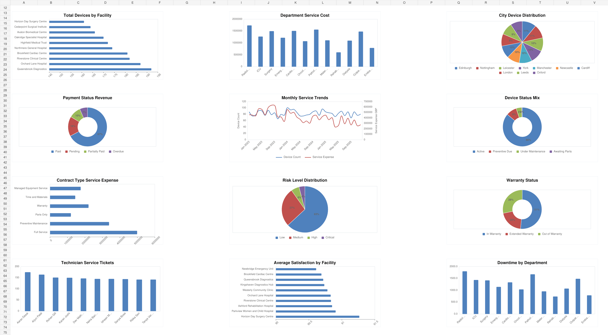

# Medical Device Analytics Dashboard

**Author: Shraddha Yadav**

An Excel operations case study covering **3,000 device records across 18 facilities and 18 cities**. The dashboard brings together revenue, service expenses, downtime, compliance labels and warranty information to explore equipment performance and maintenance priorities.

## Project Files

- [Download Excel Dashboard](./Medical_Device_Analytics_Dashboard_Shraddha_Yadav_FINAL_REAL_PIVOT.xlsx)
- [View Project Report (PDF)](./Medical_Device_Analytics_Project_Report_Shraddha_Yadav.pdf)

## Dashboard Preview

Static render of the chart section of the saved workbook. Download the Excel file to use its controls and inspect the underlying data.

## Dataset and Approach

The workbook contains 3,000 unique device records representing 7,000 recorded units. It preserves 31 original fields and adds 16 analytical fields for time periods, device age, service-cost flags and operational priorities.

The analysis uses the supplied educational case-study dataset. Its hospital and company provenance is not independently established, and the findings describe these project records.

## Tools and Features

- **Microsoft Excel:** conditional aggregation with `COUNTIFS`, `SUMIFS` and `AVERAGEIFS`.
- **13 native PivotTables** and **12 dashboard charts** for facility, department, device, financial and operational comparisons.
- **Six KPI cards:** device records, net revenue, service expense, average satisfaction score, compliance rate and High/Critical risk records.
- **Seven dropdown filters:** device category, facility, department, region, contract type, invoice status and risk category.
- Installation-date inputs, a data dictionary and supporting business insights.
- A documented Power Query transformation workflow on the `Power_Query_Steps` sheet. This is process documentation; the file does not contain an embedded executable Power Query query.

## Key Findings

These results describe the full supplied dataset with the dashboard selections set to `All`.

| Measure | Result |
| --- | ---: |
| Device records | 3,000 |
| Net revenue | £134,235,725.43 |
| Total service expense | £14,969,761.99 |
| Records labelled Compliant | 2,470 (82.33%) |
| Records labelled High or Critical risk | 293 (9.77%) |
| Recorded downtime | 14,889.4 hours |

The **368 records labelled High Cost** represent **12.27%** of records but account for **£6,049,442.61**, or **40.41%**, of total service expense. This concentration provides a useful starting point for reviewing maintenance costs within the case study.

## How to Use

1. Open the Excel download link above and select **Download raw file** on GitHub.
2. Open the workbook in Microsoft Excel, allow formulas to calculate, and select the **Dashboard** sheet.
3. Use the dropdown selections and installation-date inputs to explore the data. Return the dropdowns to `All` to review the complete dataset.
4. Use the **Pivot_Tables** sheet for detailed comparisons and read the PDF for the methodology and interpretation of the results.

## Interpretation and Workbook Scope

The Risk dropdown does not affect the High/Critical KPI; read that card alongside the other active filters. Some charts use fixed lists of ten categories, so the PivotTables provide the fuller breakdown. The current formulas and source ranges cover the supplied 3,000 records and require extension if more records are added.

Compliance and risk are labels within the project dataset. The average satisfaction card is a score, and revenue associated with invoice categories should not be treated as an unpaid receivables balance.

[Return to the portfolio](../README.md)
