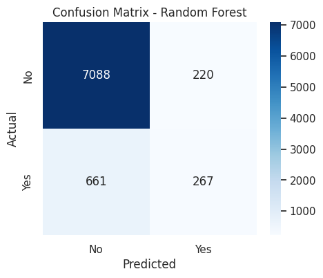
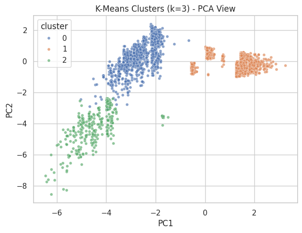

# Bank Marketing: Subscription Prediction and Customer Segmentation

**Author: Shraddha Yadav · PGDA0226 · Machine Learning Phase 6**

A classification and clustering project using the **UCI Bank Marketing** dataset. It predicts term-deposit subscription and investigates how customer/campaign segments differ in response rate and model performance.

## Project files

| File | Contents |
|---|---|
| [Jupyter notebook](ShraddhaYadav_ML_Phase6_BankMarketing.ipynb) | Complete analysis, code, interpretation and saved outputs |
| [bank-additional-full.csv](bank-additional-full.csv) | Original semicolon-delimited dataset |
| [Project report](ShraddhaYadav_ML_Phase6_Project_Report.pdf) | Methods, results, business interpretation and references |

## Data and methods

The supplied CSV contains **41,188 rows and 21 columns**, including target `y`: 36,548 `no` and 4,640 `yes` responses. The notebook removes 12 exact duplicates, leaving 41,176 observations.

- Explore target imbalance, customer characteristics and correlated numeric variables.
- Exclude `duration` from prediction because it is only available after the call; retain `unknown` as a category.
- Use numeric imputation/scaling and categorical imputation/one-hot encoding within a preprocessing pipeline.
- Compare Logistic Regression, Decision Tree and Random Forest using an **80/20 stratified split** and `random_state=42`.
- Fit K-Means to nine scaled numeric features, excluding the target and call duration. Compare `k=2` through `k=6`, and visualise the selected clusters with PCA.

## Classification results

The following are the **saved notebook results**, with precision, recall and F1 referring to the positive subscription class.

| Model | Accuracy | Precision | Recall | F1 |
|---|---:|---:|---:|---:|
| Random Forest | 0.893 | 0.548 | 0.288 | **0.377** |
| Decision Tree | 0.841 | 0.316 | 0.353 | 0.334 |
| Logistic Regression | **0.898** | **0.650** | 0.210 | 0.318 |

Random Forest achieved the highest F1 among the compared models. Its 28.8% positive recall means that many subscribers were missed. The majority-class baseline already achieved 88.73% accuracy, so accuracy alone gives an incomplete picture.



## Customer-segmentation findings

Three clusters were selected using the highest sampled silhouette score among the tested values (**0.488**). The observed subscription rates differ substantially:

| Segment, as named in the notebook | Customers | Subscription rate |
|---|---:|---:|
| Mainstream Low-Engagement | 12,001 | 19.44% |
| High-Contact Campaign | 27,637 | 4.83% |
| Previously Engaged – Higher Response | 1,538 | 63.13% |

The previously engaged segment has the highest observed response rate. The largest, high-contact segment has the lowest rate, motivating a review of repeated-contact efficiency. Model performance also differs by segment: positive recall ranges from 3.6% in the high-contact segment to 79.8% in the previously engaged segment. These are exploratory associations, not causal findings.



Both previews were extracted unchanged from the supplied notebook outputs. The PCA plot is a two-dimensional view of a sample of observations; clustering uses the full nine-feature representation.

## Open and run

GitHub can display the notebook and its saved outputs. To rerun locally:

1. Download the notebook and `bank-additional-full.csv` into the **same folder**.
2. In a Python 3 environment, install the imported packages and JupyterLab:

   ```bash
   python -m pip install jupyterlab pandas numpy matplotlib seaborn scikit-learn
   ```

3. From that folder, launch `jupyter lab`, open the notebook, and run the cells from top to bottom. The CSV filename must remain unchanged because the notebook uses a relative path.

## Evidence, limitations and attribution

The source notebook, CSV and PDF are preserved byte-for-byte. Publication checks confirmed valid notebook JSON, Python code-cell syntax, the expected CSV dimensions, 12 duplicate rows, matching relative data paths and no saved error outputs. Model training was **not rerun** during publication preparation; results above come from the existing notebook and report. Package versions are not pinned, so rerun results may vary.

The project uses default model settings without hyperparameter tuning. The same test split is used to compare and select models; there is no additional final evaluation set. Clustering is an exploratory analysis of the full dataset. The report also notes that the historical data covers 2008–2010, and that feature importance does not establish causation.

Dataset attribution and references are retained in the [original report](ShraddhaYadav_ML_Phase6_Project_Report.pdf): **UCI Bank Marketing**, and Moro, Cortez and Rita (2014), *A Data-Driven Approach to Predict the Success of Bank Telemarketing*.

[Return to the portfolio](../README.md)
