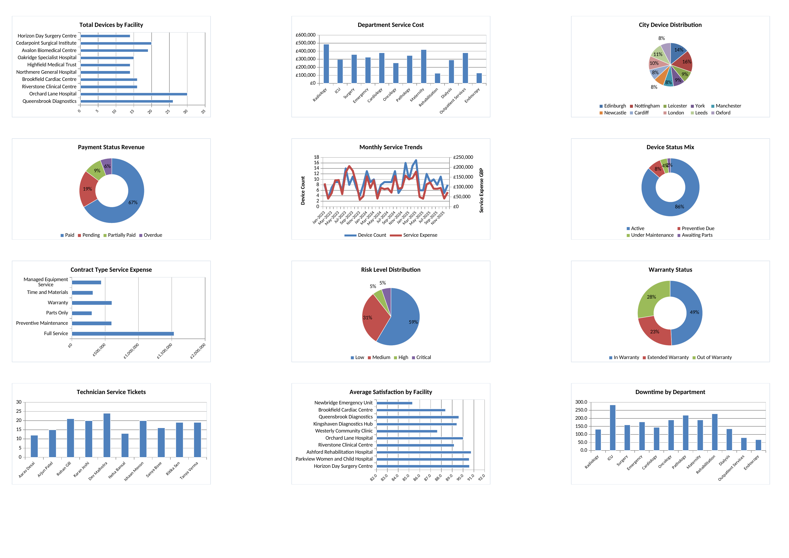

# Medical Device Operations: 10,000-Record Case Study

**Author: Shraddha Yadav**

An educational Excel case study exploring **10,000 device records across 18 facilities and 18 cities**. It covers revenue, service expenses, downtime, warranty exposure, recorded compliance status and operational risk. This is a separate dataset version of the medical-device analytics work in this portfolio.

## Project File

- [Download Excel Workbook](./Excel_Medical_Device_Operations.xlsx)

## Dashboard Preview

Static preview of the workbook's original `Dashboard` chart area, rendered with LibreOffice. It shows the workbook's saved chart state, including a device-status total of **323**, which is stale relative to the **10,000-record dataset**. Recalculate and refresh in Microsoft Excel before interpreting the dashboard; the full-data results below were calculated separately. This static preview does not verify Excel slicer interaction or the results of recalculation.

## Tools and Structure

- Microsoft Excel, **13 native PivotTables** and **12 dashboard charts**.
- Raw and prepared data, including a 47-field `Cleaned_Data` sheet.
- `COUNTIFS`, `SUMIFS` and `AVERAGEIFS` dashboard calculations.
- Seven dropdown controls and an installation-date range.
- A native Device Category slicer linked to PivotTables.
- Data dictionary, documented transformation steps and an existing narrative-insights sheet.

The documented Power Query steps describe a preparation workflow; they are not evidence of a supplied live Power Query connection.

## Findings Across All 10,000 Records

| Measure | Result |
| --- | ---: |
| Unique device IDs | 10,000 |
| Net revenue | £512,177,112.26 |
| Total service cost | £118,988,377.10 |
| Records marked Compliant | 8,297 (82.97%) |
| Records marked High or Critical risk | 3,025 (30.25%) |
| Department with highest service cost | Maternity: £9,684,052.28 |

These results were calculated from the complete `Cleaned_Data` table. They describe the case-study records and the labels stored in the workbook.

## Dataset and Interpretation

The original package does not establish that these records came from a real hospital or medical-device company. This project is presented as an **educational operations case study**. Recorded compliance and risk categories are dataset fields, rather than independently established clinical or regulatory findings.

## How to Open

1. Download the workbook and open it in Microsoft Excel.
2. Set calculation to Automatic and recalculate the workbook before reviewing its KPI values.
3. Select `Dashboard`. The seven dropdowns provide category, facility, department, region, contract, payment and risk selections.
4. Use installation dates from **14 January 2021 to 31 May 2026** to include the full date range.
5. Review and refresh the native PivotTables separately when changing their source data or slicer selections.

## Version Notes

The saved dashboard contains values that do not reconcile with the current full-dataset selections: for example, its saved device count is **323** while the formula range and selected dates cover 10,000 records. The `Business_Insights` sheet also retains narrative figures from an earlier dataset version. Recalculation and review are required before interpreting those dashboard and narrative outputs.

The table above provides the full-data results for this 10,000-record version. The original workbook is preserved unchanged.

[Return to the portfolio](../README.md)
