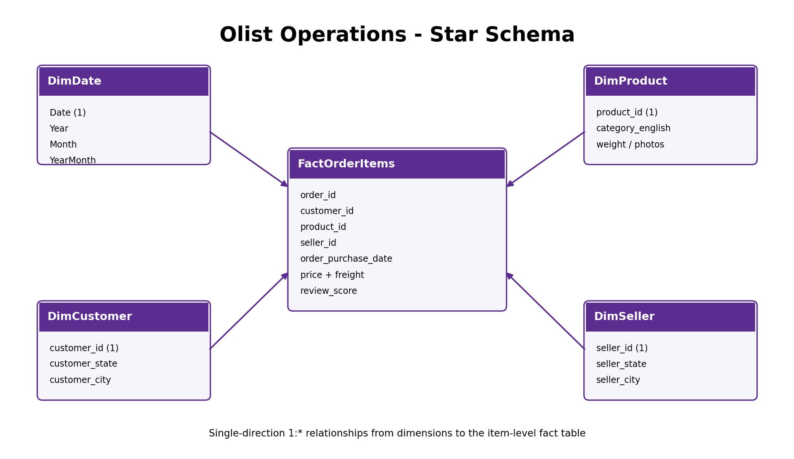
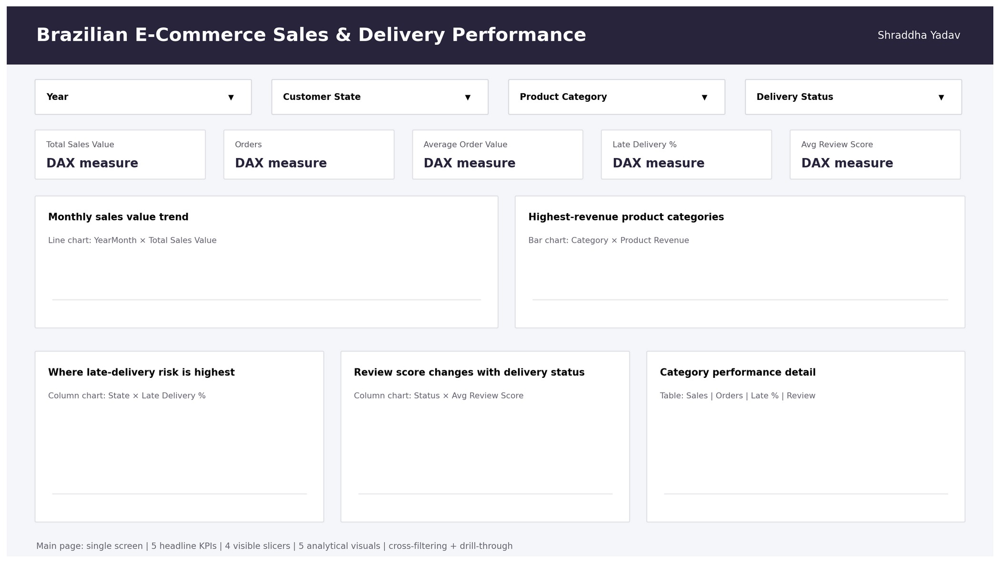

# Olist E-Commerce Operations — Power BI

**Author: Shraddha Yadav**  
**Project:** Power BI Practical Examination — Phase 5, Level 2

This project documents an operations dashboard for exploring product sales, delivery performance and customer reviews using seven related Olist e-commerce tables. The supplied report explains the planned transformations, star schema, DAX measures, executive page and category drill-through page.

## Project files and current availability

| File | Contents |
|---|---|
| [Project report](ShraddhaYadav_PowerBI_Phase5_Project_Report.pdf) | Original 11-page report, including methodology, model design, measures and dashboard layout. |
| [Olist datasets](Olist_Datasets.zip) | Original dataset archive, renamed from `data set.zip`; contains seven CSVs and `SOURCE_LINKS.txt` in the original `data set/` folder. |
| [Power BI project descriptor](ShraddhaYadav_PowerBI_Phase5.pbix.pbip) | Original 205-byte JSON `.pbip` descriptor; its filename includes `.pbix`, but it is not a standalone PBIX report. |

**Native project files are incomplete in the supplied submission.** The descriptor references `ShraddhaYadav_PowerBI_Phase5.pbix.Report`, but that report folder and the associated semantic-model files were not included. No standalone `.pbix` was supplied. The descriptor is preserved for completeness; the missing companion folders are needed to open and refresh the original project. Power BI Desktop execution and refresh have not been verified.

## Dataset coverage

The report describes historical Olist activity from 2016–2018. Counts below were checked directly against the supplied CSV files.

| Source table | Rows | Role |
|---|---:|---|
| Customers | 99,441 | Customer identifiers and locations |
| Orders | 99,441 | Order status and timestamps |
| Order items | 112,650 | Product, seller, item price and freight |
| Reviews | 99,224 | Review scores and feedback |
| Products | 32,951 | Product category and attributes |
| Sellers | 3,095 | Seller identifiers and locations |
| Category translations | 71 | Portuguese-to-English category labels |

## Findings checked from the supplied data

These are direct source-data calculations across all included order-item rows. They are not refreshed Power BI/DAX outputs. Price and freight amounts are shown in the source dataset's currency units; totals are not profit or confirmed paid revenue and are not filtered to delivered orders.

| Check | Result |
|---|---:|
| Distinct orders represented in the item table | 98,666 |
| Unique order ID + item ID pairs | 112,650 |
| Duplicate order-item keys | 0 |
| Sum of item `price` | 13,591,643.70 |
| Sum of `freight_value` | 2,256,599.44 |
| Item price plus freight | 15,848,243.14 |

Joining items to products and the category translation table identifies **health and beauty** as the largest category by summed item price in these files, followed by **watches and gifts** and **bed, bath and table**.

| Category | Summed item price |
|---|---:|
| Health and beauty | 1,258,681.34 |
| Watches and gifts | 1,205,005.68 |
| Bed, bath and table | 1,036,988.68 |
| Sports and leisure | 988,048.97 |
| Computers and accessories | 911,954.32 |

The item table covers fewer orders than the orders table, so order counts and item-based sales totals should be interpreted at their respective grains. The supplied report proposes delivery and review comparisons, but evaluated late-delivery rates, review measures and year-over-year growth cannot be confirmed from the missing native model.

## Analysis design documented in the report

- **Power Query:** assign data types, handle duplicate keys, merge order details into order items, aggregate reviews at order level before merging, and translate product categories.
- **Model:** an item-level fact table connected to customer, product, seller and date dimensions.
- **DAX measures:** product value, freight, total sales value, orders, items, customers, average order value, delivery measures, review score and time comparisons.
- **Report navigation:** an executive operations page and a category drill-through page, with year, customer state, category and delivery-status slicers.
- **Business questions:** which categories drive item value, where delivery delays occur, and how review scores vary with delivery status.

### Data-model design

The relationship design below is reproduced from the supplied report. It documents the intended structure; it is not an inspection of a loaded Power BI model.

### Dashboard design

This is the **layout figure from the supplied report**, with placeholder measure labels and chart areas. It is not a screenshot of a refreshed dashboard or evidence of populated visuals.

## How to review and continue the project

1. Read the [project report](ShraddhaYadav_PowerBI_Phase5_Project_Report.pdf) for the detailed methodology and proposed measures.
2. Download and extract [Olist_Datasets.zip](Olist_Datasets.zip). Keep the original CSV filenames inside the `data set/` folder.
3. To work with the original native Power BI project, recover the exact `ShraddhaYadav_PowerBI_Phase5.pbix.Report` folder and its associated semantic-model folder from the original project location. Place the required companion folders beside the supplied `.pbip` descriptor, preserving their relative paths.
4. Once the complete native project is available, open it in Power BI Desktop, configure the CSV paths, refresh, and verify relationships and measures before exporting dashboard screenshots.

## Sources and file checks

Dataset attribution is preserved in `data set/SOURCE_LINKS.txt` inside the archive. It identifies the [Olist Brazilian E-Commerce dataset](https://www.kaggle.com/datasets/olistbr/brazilian-ecommerce) and the [Olist dataset repository](https://github.com/olist/work-at-olist-data/tree/master/datasets).

The supplied outer ZIP and nested dataset ZIP passed archive-integrity checks. All seven CSVs were read for row-count validation, the item-key check and the totals above. The original PDF, project descriptor and dataset archive were preserved byte-for-byte; only the dataset archive's display filename was changed. The two PNG figures were extracted from the original PDF.

[Return to the portfolio](../README.md)
