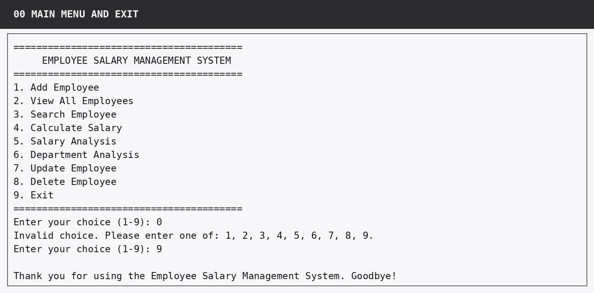
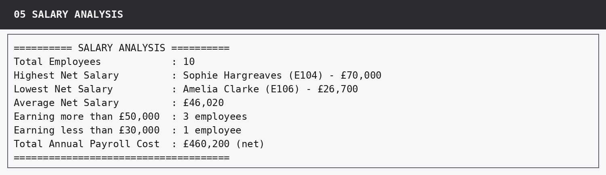

# Employee Salary Management System

**Author: Shraddha Yadav · PGDA0226 · Python Phase 3**

A menu-driven Python application for managing employee records, calculating gross and net salary, and analysing pay across departments. The project demonstrates functions, loops, conditionals, lists, dictionaries, input validation and formatted console output.

## Project files

| File | Contents |
|---|---|
| [employee_salary_system.py](employee_salary_system.py) | Complete executable Python source, including 10 starter records |
| [Detailed project report](Shraddha_Yadav_Final_Detailed_Project_Report.docx) | Design, implementation, calculations and project explanation |
| [Output evidence](Shraddha_Yadav_Output_Evidence.docx) | Existing console-output screenshots and documented checks |

## Features

- Add, view, search, update and delete employee records; deletion requires confirmation.
- Search by employee ID or full name, with case-insensitive matching.
- Calculate **gross salary = basic salary + allowance + bonus**, then **net salary = gross salary − deduction**.
- Report highest, lowest and average net salary, total annual net salary, and salary-threshold counts.
- Summarise employee count, total net salary and average net salary by department.
- Validate unique IDs, nonempty inputs and finite, nonnegative monetary values; handle missing records and invalid menu choices.

## Results from the included starter data

| Measure | Result |
|---|---:|
| Employees | 10 |
| Departments | 5 |
| Total annual net salary | £460,200 |
| Average annual net salary | £46,020 |
| Highest annual net salary | £70,000 |
| Lowest annual net salary | £26,700 |
| Employees earning more than £50,000 | 3 |
| Employees earning less than £30,000 | 1 |

These values are shown in the supplied output evidence and agree with calculations from the starter records in the source file.

## Preview





Both images were extracted unchanged from the supplied **Output Evidence** document. They show the project's existing captured console output.

## Run the project

1. Download `employee_salary_system.py`, or clone/download the portfolio repository.
2. Open a terminal in this project folder with Python 3 installed.
3. Run:

   ```bash
   python employee_salary_system.py
   ```

   Use `python3` if that is your system's Python 3 command. No third-party packages are required.
4. Choose options **1–8** to use the modules and **9** to exit.

Records are held in memory. Additions and edits are lost when the program exits; each new run loads the starter records. The salary figures use supplied annual components and do not calculate statutory tax or National Insurance.

## Verification and scope

The original Python and Word files are preserved byte-for-byte from the submitted archive. Publication checks covered Python parsing/compilation, source inspection, starter-record arithmetic, document archive integrity and preview readability. The original evidence document contains the earlier functional checks; the complete interactive test sequence was not rerun during publication preparation.

[Return to the portfolio](../README.md)
