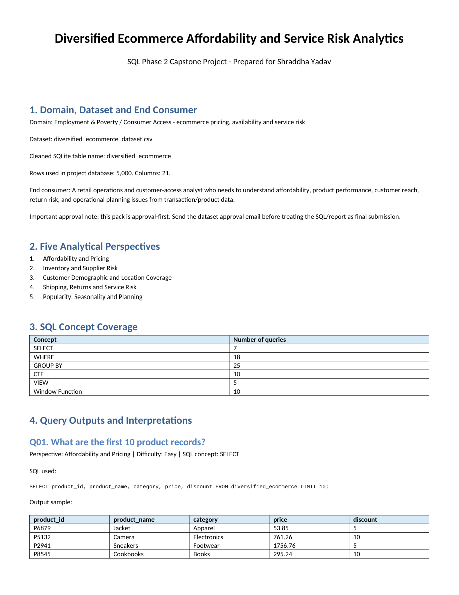

# Diversified Ecommerce Affordability and Service Risk Analytics

**Portfolio: Shraddha Yadav · SQL Phase 2**

A SQL study of product affordability, inventory and supplier exposure, customer coverage, shipping and return risk, and seasonality, using the supplied 5,000-row, 21-column cleaned product dataset.

## Tools and data

SQLite; SQL aggregations, CTEs, views and window functions; CSV data; PDF/Word report.

## Key findings

- The supplied dataset contains **five product categories**. Q06 returns Footwear as the highest average final-price category (**1,004.56**, 1,008 records), followed by Electronics (**1,001.64**, 1,051 records). Currency is not specified in the supplied data.
- The supplied flag columns identify **476 low-stock records** and **2,597 high-return records**. These counts use the existing flags; their thresholds are defined by the original preparation and analysis.
- The report and SQL organise the work into pricing, inventory, customer coverage, service risk and planning, using aggregations, CTEs, views and window functions.

## Project files

| File | Contents |
|---|---|
| [ShraddhaYadav_SQLPhase2_Project_2_Diversified_Ecommerce_Project.sql](./ShraddhaYadav_SQLPhase2_Project_2_Diversified_Ecommerce_Project.sql) | Original combined SQL script, preserved byte-for-byte |
| [Project_2_Diversified_Ecommerce_Cleaned_5000.csv](./Project_2_Diversified_Ecommerce_Cleaned_5000.csv) | Supplied cleaned dataset, preserved byte-for-byte |
| [ShraddhaYadav_SQLPhase2_Project_2_Diversified_Ecommerce_Report.pdf](./ShraddhaYadav_SQLPhase2_Project_2_Diversified_Ecommerce_Report.pdf) | 23-page project report, preserved byte-for-byte |
| [analysis.sqlite](./analysis.sqlite) | Companion SQLite database: 5,000 source rows and 5 original views |
| [Project_Files.zip](./Project_Files.zip) | Complete original internal file tree plus companion database under Portfolio_Support/ |

## Open and run

1. Download [analysis.sqlite](./analysis.sqlite) and [the SQL script](./ShraddhaYadav_SQLPhase2_Project_2_Diversified_Ecommerce_Project.sql).
2. Open `analysis.sqlite` in a SQLite client such as DB Browser for SQLite. The populated table is `diversified_ecommerce`; the source views are already included.
3. Open the SQL file in the SQL editor and run the numbered queries you want to inspect. Use a current SQLite build with window-function support.
4. Alternatively, extract [Project_Files.zip](./Project_Files.zip); the database is in `Portfolio_Support/analysis.sqlite`, alongside the preserved original archive layout.

The original SQL script assumes a populated database and does not import the CSV. The added companion database supplies that missing runtime input without changing the script.

The companion database was created only from the supplied cleaned CSV: blank cells become NULL, numeric measures use numeric SQLite types, and text identifiers/dates remain text. Source SQL and data files were not rewritten.

## Verification and limitations

ZIP CRC checks passed and every original archived file was verified byte-for-byte. The companion database passed `PRAGMA integrity_check`, the 5,000-row count check and a complete comparison with the typed CSV values. Its 5 source view definitions were installed successfully. Original query **Q06** executed successfully. The remaining queries were not rerun.

The original report includes a dataset-approval reminder; approval evidence was not supplied. The data describe the provided product records and are not independently authenticated as production business transactions.

## Report preview

The image below is a genuine render of the supplied report's first page; it is a report preview, not a dashboard screenshot.

[Back to the portfolio](../README.md)
