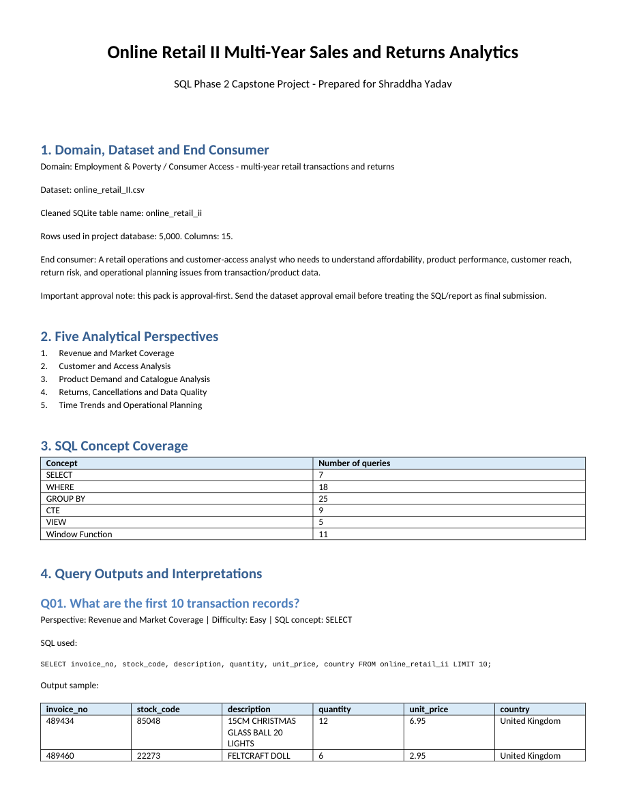

# Online Retail II Sales and Returns Analytics

**Portfolio: Shraddha Yadav · SQL Phase 2**

A 75-query retail analysis covering revenue and market coverage, customer reach, product demand, returns and data quality, and time trends. The supplied cleaned sample has **5,000 transaction lines and 15 columns**, spanning **2009-12-01 to 2011-12-09**.

## Tools and data

SQLite; SQL aggregations, CTEs, views and window functions; CSV data; PDF/Word report.

## Key findings

- The supplied sample covers **34 countries**. Source Q06 returns **United Kingdom** as the highest net line-revenue country, at **83,402.03** across **4,603 lines**. This includes negative line-revenue values; currency is not independently established here.
- **85 rows** carry the supplied cancellation flag. Cancellation flags are not a complete measure of every possible business return.
- **1,140 rows** have no customer ID. The companion database imports those blank fields as SQL NULL so the original missing-customer queries work as intended.

## Project files

| File | Contents |
|---|---|
| [ShraddhaYadav_SQLPhase2_Project_4_Online_Retail_II_Project.sql](./ShraddhaYadav_SQLPhase2_Project_4_Online_Retail_II_Project.sql) | Original combined SQL script, preserved byte-for-byte |
| [Project_4_Online_Retail_II_Cleaned_5000.csv](./Project_4_Online_Retail_II_Cleaned_5000.csv) | Supplied cleaned dataset, preserved byte-for-byte |
| [ShraddhaYadav_SQLPhase2_Project_4_Online_Retail_II_Report.pdf](./ShraddhaYadav_SQLPhase2_Project_4_Online_Retail_II_Report.pdf) | 24-page project report, preserved byte-for-byte |
| [analysis.sqlite](./analysis.sqlite) | Companion SQLite database: 5,000 source rows and 5 original views |
| [Project_Files.zip](./Project_Files.zip) | Complete original internal file tree plus companion database under Portfolio_Support/ |

## Open and run

1. Download [analysis.sqlite](./analysis.sqlite) and [the SQL script](./ShraddhaYadav_SQLPhase2_Project_4_Online_Retail_II_Project.sql).
2. Open `analysis.sqlite` in a SQLite client such as DB Browser for SQLite. The populated table is `online_retail_ii`; the source views are already included.
3. Open the SQL file in the SQL editor and run the numbered queries you want to inspect. Use a current SQLite build with window-function support.
4. Alternatively, extract [Project_Files.zip](./Project_Files.zip); the database is in `Portfolio_Support/analysis.sqlite`, alongside the preserved original archive layout.

The original SQL script assumes a populated database and does not import the CSV. The added companion database supplies that missing runtime input without changing the script.

The companion database was created only from the supplied cleaned CSV: blank cells become NULL, numeric measures use numeric SQLite types, and text identifiers/dates remain text. Source SQL and data files were not rewritten.

## Verification and limitations

ZIP CRC checks passed and every original archived file was verified byte-for-byte. The companion database passed `PRAGMA integrity_check`, the 5,000-row count check and a complete comparison with the typed CSV values. Its 5 source view definitions were installed successfully. Original query **Q06** executed successfully. The remaining queries were not rerun.

The original report includes a dataset-approval reminder; approval evidence was not supplied. Findings describe the supplied 5,000-row sample and should not be presented as totals for the full original retail dataset.

## Report preview

The image below is a genuine render of the supplied report's first page; it is a report preview, not a dashboard screenshot.

[Back to the portfolio](../README.md)
