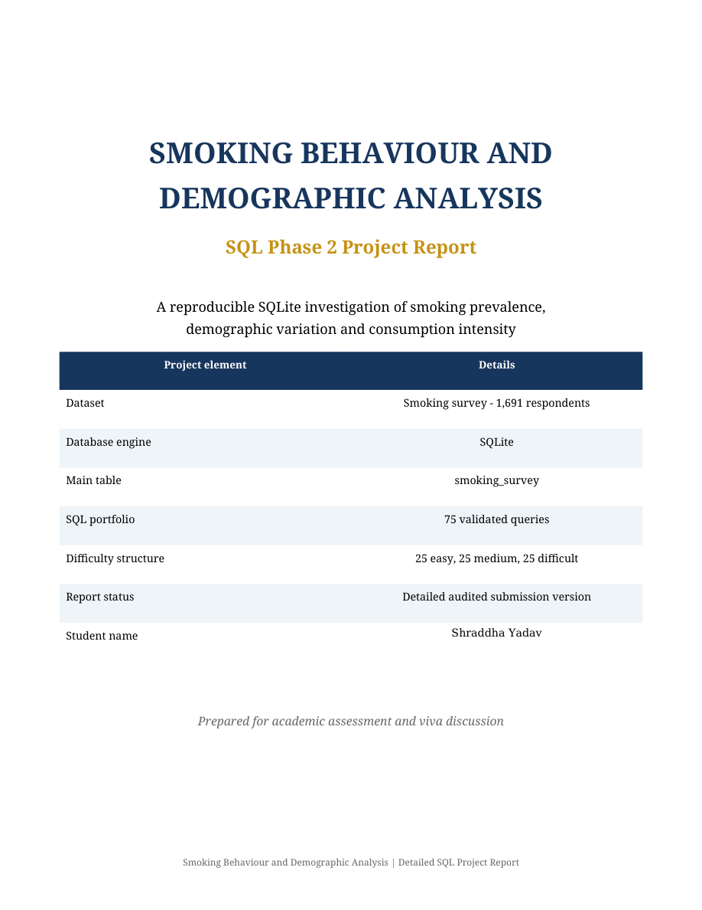

# Smoking Behaviour and Demographic Analysis

**Portfolio: Shraddha Yadav · SQL Phase 2**

A descriptive survey analysis of smoking prevalence, demographic variation and reported consumption, using 1,691 respondents and 17 cleaned/derived columns.

## Tools and data

SQLite; SQL aggregations, CTEs, views and window functions; CSV data; PDF/Word report.

## Key findings

- The supplied sample contains **421 smokers and 1,270 non-smokers**, giving a **24.90%** smoking rate. The source Q26 was rerun successfully on the companion database.
- The supplied report records higher smoking prevalence among ages 18–24 (37.24%) and 25–34 (35.11%) than ages 65+ (11.41%). These are descriptive sample associations.
- The report estimates average weekly consumption of 101.57 cigarettes among smokers and distinguishes weekday from weekend consumption. These reported consumption results were not independently rerun during portfolio preparation.

## Project files

| File | Contents |
|---|---|
| [StudentName_SQLPhase2_Project_1_Smoking_Behaviour_Analysis_Project.sql](./StudentName_SQLPhase2_Project_1_Smoking_Behaviour_Analysis_Project.sql) | Original combined SQL script, preserved byte-for-byte |
| [Project_1_Smoking_Survey_Cleaned_1691.csv](./Project_1_Smoking_Survey_Cleaned_1691.csv) | Supplied cleaned dataset, preserved byte-for-byte |
| [ShraddhaYadav_Smoking_Behaviour_Report.pdf](./ShraddhaYadav_Smoking_Behaviour_Report.pdf) | 24-page project report — identity-only corrected copy |
| [analysis.sqlite](./analysis.sqlite) | Companion SQLite database: 1,691 source rows and 5 original views |
| [Project_Files.zip](./Project_Files.zip) | Complete original internal file tree plus companion database under Portfolio_Support/ |

## Open and run

1. Download [analysis.sqlite](./analysis.sqlite) and [the SQL script](./StudentName_SQLPhase2_Project_1_Smoking_Behaviour_Analysis_Project.sql).
2. Open `analysis.sqlite` in a SQLite client such as DB Browser for SQLite. The populated table is `smoking_survey`; the source views are already included.
3. Open the SQL file in the SQL editor and run the numbered queries you want to inspect. Use a current SQLite build with window-function support.
4. Alternatively, extract [Project_Files.zip](./Project_Files.zip); the database is in `Portfolio_Support/analysis.sqlite`, alongside the preserved original archive layout.

The smoking script also contains a full rebuild, including DROP TABLE, schema and inserts. Run that full script only in a separate project database; it replaces its named table.

The companion database was created only from the supplied cleaned CSV: blank cells become NULL, numeric measures use numeric SQLite types, and text identifiers/dates remain text. Source SQL and data files were not rewritten.

## Verification and limitations

ZIP CRC checks passed and every original archived file was verified byte-for-byte. The companion database passed `PRAGMA integrity_check`, the 1,691-row count check and a complete comparison with the typed CSV values. Its 5 source view definitions were installed successfully. Original query **Q26** executed successfully. The remaining queries were not rerun.

The original report describes an earlier full 75-query validation. That validation was not repeated here. Its referenced `QUERY_OUTPUT_VALIDATION_75.csv` was not present in the supplied archive. The visible PDF corrects only the cover identity and matching checklist text to Shraddha Yadav; the original PDF and Word report remain unchanged inside the ZIP. Original SQL filenames retain their supplied `StudentName` prefix.

## Report preview

The image below is a genuine render of the supplied report's first page with the identity correction noted above; it is a report preview, not a dashboard screenshot.

[Back to the portfolio](../README.md)
