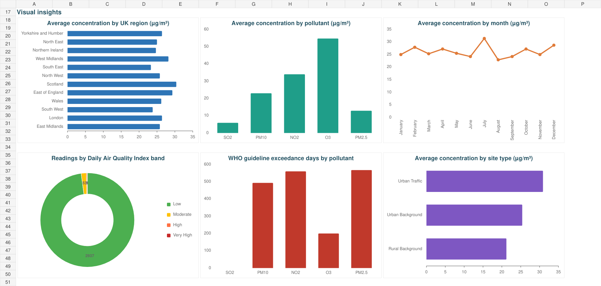

# UK Air Quality Dashboard

**Author: Shraddha Yadav**

An Excel analytics project exploring **3,000 air-quality records for 2024**, covering **34 monitoring sites, 12 UK regions and five pollutants**. The dashboard presents regional, seasonal and pollutant comparisons for environmental analysis and data-visualisation practice.

## Project Files

- [Download Excel Dashboard](./ShraddhaYadav_UKDashboard.xlsx)
- [View Project Report (PDF)](./ShraddhaYadav_UKDashboard_Report.pdf)
- [Download Editable Report (Word)](./ShraddhaYadav_UKDashboard_Report.docx)

## Dashboard Chart Preview

Static render of the chart section of the saved workbook. Download the Excel file to review the KPI cards and use the native slicers.

## Tools and Features

- **Microsoft Excel:** six native PivotTables and six dashboard charts.
- **Four slicers:** Region, Pollutant, Site Type and Season.
- **Six KPI cards:** readings in view, average concentration, WHO-threshold flag percentage and count, Low-band percentage, and High/Very High-band record count.
- A **19-field dataset**, data dictionary and dataset documentation.
- Matching PDF and Word reports explaining the methodology, audience and dashboard design.

## Dataset Overview

| Measure | Coverage |
| --- | --- |
| Records | 3,000 |
| Year | 2024 |
| Monitoring sites | 34 |
| UK regions | 12 |
| Pollutants | NO2, PM2.5, PM10, O3 and SO2 |
| Dataset fields | 19 |

## Key Findings in the Project Dataset

| Stored workbook classification | Records | Share of records |
| --- | ---: | ---: |
| Threshold flag recorded | 1,820 | 60.67% |
| Low air-quality band | 2,937 | 97.90% |
| High or Very High air-quality band | 10 | 0.33% |

These counts describe the classifications stored in the supplied project data. Threshold flags and air-quality bands use different rules. Read the interpretation notes below before drawing conclusions about measured exposure or regulatory compliance.

## How to Use

1. Open the Excel link above and select **Download raw file** on GitHub.
2. Open the workbook in Microsoft Excel and select the **Dashboard** sheet.
3. Use the slicers to explore the data; select **Clear Filter** to reset each selection.
4. Use **Data → Refresh All** after updating the source data. Refer to the PDF for the project methodology and supporting discussion.

## Data Reference and Interpretation

The workbook describes a prepared project dataset reflecting the Automatic Urban and Rural Network (AURN) structure. The report cites the [DEFRA UK-AIR Data Archive](https://uk-air.defra.gov.uk/data/); the package does not provide a reproducible source extract for independent provenance checking.

Threshold flags are exploratory comparisons using the values stored in the workbook. The report and workbook use different reference values for **ozone (O3)** and **sulphur dioxide (SO2)**. Regulatory interpretation requires consistent thresholds and the correct averaging periods; comparing individual daily readings with annual guidelines does not establish regulatory noncompliance.

The report's KPI descriptions differ from the current workbook's cards. The chart labelled **"exceedance days"** counts flagged records, including repeated date/site/pollutant combinations; it is not a distinct-day count.
