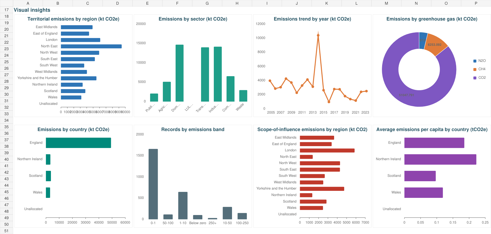

# UK Greenhouse Gas Emissions Dashboard

**Author: Shraddha Yadav**

An Excel analytics project exploring **3,000 working records and 19 fields covering 2005–2023**. Designed for council officers, sustainability teams and other nontechnical users, the dashboard compares greenhouse-gas emissions by geography, sector, gas and year.

## Project Files

- [Open Excel Dashboard](./ShraddhaYadav_UKDashboard.xlsx)
- [View Project Report (PDF)](./ShraddhaYadav_UKDashboard_Report.pdf)
- [Download Editable Report (Word)](./ShraddhaYadav_UKDashboard_Report.docx)

## Dashboard Chart Preview

Static render of the chart section of the saved workbook. Download the Excel file to review the KPI cards and use the native slicers.

## Tools and Features

- **Microsoft Excel:** eight PivotTables and eight dashboard charts.
- **Five slicers:** Country, Region, Calendar Year, Sector and Greenhouse gas.
- **Six KPI cards:** territorial emissions, records in view, scope-of-influence emissions, CO2 emissions, average emissions per record and CO2 share.
- Analysis of **eight sectors** and **three gases: CO2, CH4 and N2O**.
- Supporting dataset, source documentation and data dictionary.

## Findings from the Working Dataset

| Measure | Result |
| --- | ---: |
| Records analysed | 3,000 |
| Territorial emissions in the extract | 59,537.97 kt CO2e |
| CO2 share of territorial emissions | 85.74% |
| Largest sector by emissions | Domestic |

These results describe the included records across multiple years; they are not annual UK totals or representative national estimates.

## Data Source

The workbook cites the Department for Energy Security and Net Zero (DESNZ):

[UK local authority and regional greenhouse gas emissions statistics, 2005 to 2023 — GOV.UK](https://www.gov.uk/government/statistics/uk-local-authority-and-regional-greenhouse-gas-emissions-statistics-2005-to-2023).

## How to Use

View the PDF report for the methodology and findings. Download the workbook, open it in Microsoft Excel, select the **Dashboard** sheet and use the slicers to explore the working dataset.
