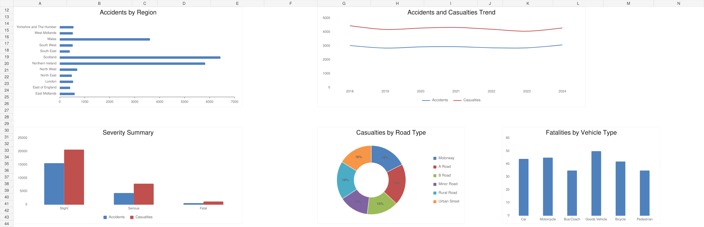

# UK Road Safety Demonstration

**Author: Shraddha Yadav**

An Excel dashboard using **7,000 constructed demonstration records** to practise geographic, trend, severity and road-user analysis. The dataset covers the years **2018–2024**, four country labels, 12 region labels and 18 fields.

The records were created for an educational dashboard exercise. They are not official observed UK collision statistics.

## Project File

- [Download Excel Workbook](./Excel_UK_Road_Safety_Demonstration.xlsx)

## Dashboard Preview

Static render of the saved workbook's chart section. The charts describe the constructed demonstration dataset.

## Tools and Structure

- Microsoft Excel with **five native charts** and six KPI calculations.
- Six dropdown controls: Year, Region, Severity, Road Type, Vehicle Type and Country.
- `SUMPRODUCT` calculations for filtered totals.
- Formula summaries in `Pivot_Query` and linked summaries in `Pivot_Tables`.
- Raw demonstration data and an embedded project guide/data dictionary.

The summary sheets use formulas; this workbook does not contain native Excel PivotTable or slicer objects.

## Findings from the Demonstration Dataset

| Measure | Result |
| --- | ---: |
| Constructed records | 7,000 |
| Sum of simulated accidents | 20,609 |
| Sum of simulated casualties | 29,834 |
| Sum of simulated fatalities | 251 |
| Sum of simulated serious injuries | 4,853 |
| Casualties divided by accidents | 1.45 |
| Sum of constructed estimated costs | £5,141,790,488 |

The figures are calculated from `Raw_Data`. A record can contain more than one simulated accident, so the number of records and the sum of the Accidents field measure different things.

Within this constructed dataset, **Scotland** has the largest accident total at **6,436**, and **A Road** has the largest road-type total at **4,142**. These patterns illustrate the analysis workflow and should not be interpreted as real geographic or road-safety comparisons.

## How to Use

1. Download the workbook and open it in Microsoft Excel.
2. Set calculation to Automatic and recalculate the workbook.
3. Select `Dashboard` and use the yellow dropdown cells in `B5:B10`.
4. Set every dropdown to **All** to review full-dataset totals.
5. Inspect `Pivot_Query`, `Pivot_Tables` and `Raw_Data` to trace the calculations.

Some saved values in the linked `Pivot_Tables` sheet are zero caches. Recalculate before relying on those summaries or their display.

## Data Source

The `Project_Info` sheet explicitly identifies the source as a demonstration dataset created from scratch with fields inspired by UK road-safety reporting. All totals and estimated costs in this project belong to that constructed dataset.

[Return to the portfolio](../README.md)
